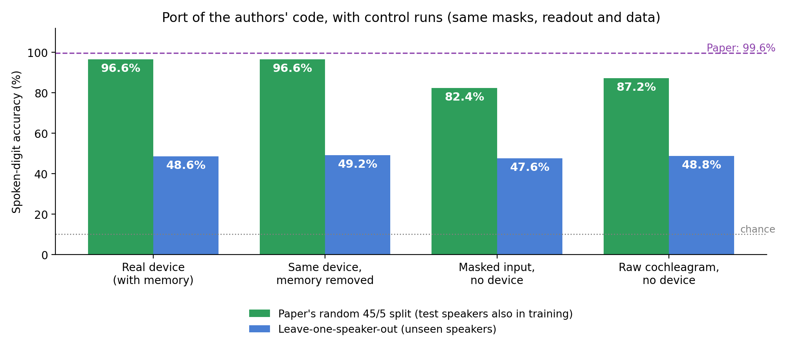

# Dynamic-memristor reservoir computing: a replication with control runs

A self-study replication of spoken-digit recognition with a TaOx dynamic-memristor reservoir. I
ported the authors' code to Python, then ran control experiments to check what actually carries
the accuracy.

> **Source paper:** Zhong, Y., Tang, J., Li, X., Gao, B., Qian, H., & Wu, H. Dynamic
> memristor-based reservoir computing for high-efficiency temporal signal processing.
> *Nature Communications* 12, 408 (2021). [doi:10.1038/s41467-020-20692-1](https://doi.org/10.1038/s41467-020-20692-1)



## Highlights

The controls use the same masks, readout and data as the port; only the step that produces the
features changes.

| Features | Paper's random 45/5 split | Leave-one-speaker-out |
|---|---|---|
| Real device (with memory) | **96.6 %** (94–98 % per repeat) | 48.6 % |
| Same device, memory removed | 96.6 % | 49.2 % |
| Masked input, no device | 82.4 % | 47.6 % |
| Raw cochleagram, no device | 87.2 % | 48.8 % |
| Paper (measured hardware) | 99.6 % | – |

**What this shows:** the port reproduces the paper's pipeline closely (96.6 % vs 99.6 %). But in
this model the score does not change when the device's memory is removed, and every version,
including features with no device at all, falls to about 49 % for speakers not seen in training.
The device model's gain over masked input comes from its nonlinearity, not its memory.

## In this repository

`dynamic_memristor.py` is a minimal example of the published device model and its fading memory.

```bash
pip install -r requirements.txt
python dynamic_memristor.py
```

The full replication code is not public. Happy to discuss the work: see
[achyar99.github.io](https://achyar99.github.io).

Achyarul Mabruri · MIT licence for the code in this repository.
