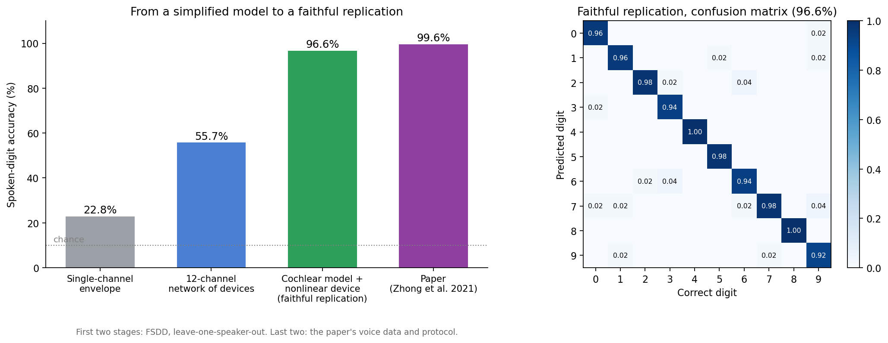

# Dynamic-memristor reservoir computing: a step-by-step replication

A self-study replication of spoken-digit recognition with a TaOx dynamic-memristor reservoir. It
starts from a simplified model of my own and builds up to a faithful rebuild of the published
system.

> **Source paper:** Zhong, Y., Tang, J., Li, X., Gao, B., Qian, H., & Wu, H. Dynamic
> memristor-based reservoir computing for high-efficiency temporal signal processing.
> *Nature Communications* 12, 408 (2021). [doi:10.1038/s41467-020-20692-1](https://doi.org/10.1038/s41467-020-20692-1)



## Highlights

| Stage | Accuracy |
|---|---|
| Simplified single-channel model | 22.8 % |
| Multi-channel network of devices | 55.7 % |
| Faithful replication | **96.6 %** |
| Paper (measured hardware) | 99.6 % |

The first two stages use a different dataset and protocol from the last two, so they show
progress, not a like-for-like comparison. The main lesson: the input encoding, not the device
alone, carried most of the accuracy.

## In this repository

`dynamic_memristor.py` is a minimal example of the published device model. It shows the fading
memory that makes the device useful as a reservoir.

```bash
pip install -r requirements.txt
python dynamic_memristor.py
```

The full replication code is not public. Happy to discuss the work: see
[achyar99.github.io](https://achyar99.github.io).

Achyarul Mabruri · MIT licence for the code in this repository.
